# 系统架构与详细设计文档：数据脱敏中心

## 1. 整体架构流水线

```mermaid
flowchart LR
    subgraph Inbound["认证与接入网关"]
        CONSOLE["Vue 3 控制台 (JWT)"]
        REST_CLIENT["外部调用方 / 评测中心 (X-API-Key)"]
    end

    subgraph Dispatcher["请求编排与连接器层"]
        SYNC_H["同步脱敏处理器 (内存零落盘)"]
        BATCH_H["异步批处理 Worker (MySQL 状态机)"]
        FILE_STREAM["流式文件读取器 (try/finally 即读即焚)"]
        RO_MYSQL["只读 MySQL 游标抽样器 (READ ONLY 会话)"]
    end

    subgraph Engine["三层可编排脱敏内核"]
        SCOPE["一致性脱敏作用域 (EphemeralScopeDict)"]
        ROLE["JSONPath 字段角色路由器 (FULL / REPLAY_HIGH_RISK / SKIP)"]
        subgraph HybridDetectors["混合实体检测管线"]
            ONNX_POOL["AstrLink Guard v0.1.3 推理线程池 (INT8 ONNX 512/128 滑窗)"]
            REGEX_DET["中国大陆强校验检测器 (身份证校验位 / 社会信用代码 / 手机 / Luhn)"]
            ALLOW_FLT["白名单豁免过滤器 (EXACT / SUFFIX / REGEX)"]
        end
        REPLACER["倒序偏移替换与掩码生成器"]
    end

    subgraph Storage["零明文持久化层"]
        DB[("MySQL 8.0: kd_desensitize")]
        VOL[("本地受控产物卷 data/artifacts (TTL 自动清理)")]
    end

    CONSOLE --> SYNC_H
    CONSOLE --> BATCH_H
    REST_CLIENT --> SYNC_H
    REST_CLIENT --> BATCH_H

    BATCH_H --> FILE_STREAM --> ROLE
    BATCH_H --> RO_MYSQL --> ROLE
    SYNC_H --> ROLE

    ROLE --> HybridDetectors
    HybridDetectors --> SCOPE --> REPLACER
    REPLACER -->|"仅命中计数与任务状态"| DB
    REPLACER -->|"仅脱敏后文件"| VOL
```

---

## 2. `AstrLink Guard` v0.1.3 本地推理与滑窗解码契约

基于官方模型卡核实的底层技术参数实现确定性解码：

1. **模型加载与运行时隔离**：
   - 默认加载 `models/astrlink-guard/int8/model_int8.onnx`（需同目录保留外部权重 `model_int8.onnx_data`、`tokenizer.json`、`labels.json`、`config.json`），使用 `CPUExecutionProvider`。
   - 可通过环境变量切换 `fp32/model.onnx` 或 GPU `fp16/model_fp16_static512.onnx`（注意 FP16 固定 `1 × 512` 输入，padding 位置必须使用 XLM-R 的 `pad_id = 1`、`attention_mask = 0`、`token_type_ids = 0`，推理后截掉 padding 位）。
   - `onnxruntime.InferenceSession` 运行在固定大小的 `ThreadPoolExecutor` 中（`asyncio.to_thread` 调度），避免阻塞 FastAPI 主事件循环。
2. **512 Token 滑窗与 128 Token 重叠合并**：
   - 使用 `tokenizers.Tokenizer` 编码整段文本并获取每个 token 的 Unicode 字符区间 `offsets = (char_start, char_end)`。
   - 若总 token 数（含首尾特殊符号）$\le 512$，单窗一次推理；若 $> 512$，按有效内容步长 `stride = 382`（加首尾 `<s>`、`</s>` 后窗口满 512，相邻窗口重叠 128 tokens）切片推理。
   - 对每个窗口输出 `logits`（形状 `1 × L × 21`）做数值稳定 Softmax，遵循 `bio-offset-consistency-v1` 解码：跳过 `start == end` 的特殊 token；遇到 `B-X` 或前序标签非 `X` 时开启新 Span，遇到 `I-X` 扩展 `end` 并取 `score = min(cur.score, p_token)`；对 `ip_address` 与 `url` 执行边界收缩/扩展修正，过滤掉 `score < policy.threshold`（默认 `0.80`）的低置信候选。
   - 跨窗口重叠区合并：若两个相邻窗口识别出的同类或重叠字符区间满足交集 $> 0$，合并为并集区间或保留高分/更完整区间（详见冲突消解规则）。

---

## 3. 中国大陆强规则检测器与多源区间冲突消解

### 3.1 四类确定性校验检测器（得分固定 `1.0`）
1. **`cn_id_card`（18 位公民身份号码）**：匹配 `[1-9]\d{5}(19|20)\d{2}(0[1-9]|1[0-2])(0[1-9]|[12]\d|3[01])\d{3}[\dXx]`，并校验前 17 位加权因子 `[7,9,10,5,8,4,2,1,6,3,7,9,10,5,8,4,2]` 模 11 校验码是否严格匹配第 18 位，同时校验出生日期合法性。
2. **`cn_uscc`（18 位统一社会信用代码）**：校验字符集（不含 `I,O,Z,S,V`）与 GB 32100-2015 MOD 31 校验位。
3. **`cn_mobile`（中国大陆 11 位个人手机号）**：匹配非数字边界包裹的 `1[3-9]\d{9}`。
4. **`bank_card_luhn`（16~19 位银行卡号）**：匹配连续卡号并通过 Luhn 模 10 校验（排除已命中的 18 位身份证）。

### 3.2 区间优先级与白名单豁免算法
对同一段文本汇总 ONNX Span 与 Regex Span 后，按以下确定性顺序收敛为互不重叠的有序区间列表：
1. **白名单豁免剔除**：若候选区间文本命中当前策略关联的 `ds_allowlist_dict`（例如公开热线 `12345`/`12333`/`12329`、`0519-` 政务办公电话列表、`*.gov.cn` URL、公开政务服务大厅地址），直接丢弃该候选。
2. **重叠区间消解**：按 `(char_len DESC, priority_detector_regex_first DESC, score DESC, start ASC)` 排序贪心选取不重叠区间——例如 18 位身份证若被 ONNX 局部识别为 `private_date`（中间生日段），因 `cn_id_card` 长度更长（18 > 8）且强校验优先，完整采纳 `cn_id_card` 而淘汰内部的局部子区间。
3. **倒序字符切片替换**：将最终确认区间按 `start DESC` 从后往前替换文本，确保前序字符偏移不被破坏。

---

## 4. 一致性脱敏作用域与结构化字段角色映射

为满足多轮对话与 RAG 评测语料的“指代不断裂 + 公共知识不误伤”，引擎引入 `EphemeralScopeDict`（仅驻留单次函数栈帧内存）：

1. **三类字段角色（Field Role）**：
   - `FULL_MASK_WRITE_SCOPE`（默认绑定用户提问 `query`、`turns[role=user].content`）：运行策略启用的全部检测器，每当命中某明文 `v`（归一化去首尾空白），先查 `scope_dict[(entity_group, v)]`；若不存在则分配递增序号如 `<PERSON_1>`、`<PHONE_1>` 并写入 `scope_dict`，随后执行替换。
   - `REPLAY_SCOPE_AND_HIGH_RISK`（默认绑定助手回答 `answer`、`turns[role=assistant].content`、知识引用 `references[*].content`）：
     1. **第一遍（作用域精确回放）**：将 `scope_dict` 中已登记的用户侧隐私明文（按长度降序，防子串覆盖）在助手/引用文本中做精确字面替换（例如把“张三您好”替换为 `<PERSON_1>您好`）；
     2. **第二遍（仅高危标签补扫）**：仅执行强隐私高危标签（默认 `cn_id_card`、`cn_mobile`、`bank_card_luhn`、`payment_card`、`common_secret`），**跳过** `private_address`、固话 `phone` 与普通 `url`，从而 100% 保留政务大厅地址、办公固话和 `.gov.cn` 网址。
   - `PASSTHROUGH`（元数据透传字段，如 `case_code`、`turn_mode`、`role`）：原样保留不扫描。
2. **处理顺序保证**：对于结构化 JSON 对象或会话数组，引擎固定**先遍历所有 `FULL_MASK_WRITE_SCOPE` 路径以建立完整的用户隐私作用域字典，再遍历所有 `REPLAY_SCOPE_AND_HIGH_RISK` 路径**；整个记录返回前显式清空 `scope_dict` 引用。
