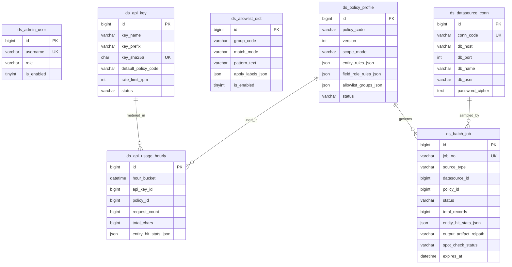

# 数据库模型设计文档：数据脱敏中心 (`kd_desensitize`)

## 1. 设计准则与安全边界

1. **物理库隔离**：使用独立 MySQL 8.0 数据库 `kd_desensitize`，不与任何上游业务系统共库或跨库连表。
2. **零明文落库铁律**：全库 7 张表**没有任何列用于保存待脱敏原文、脱敏前快照或“明文 ↔ 占位符”还原字典**。`ds_api_key` 仅存 `SHA-256` 摘要；`ds_datasource_conn` 密码使用应用层主密钥 `AES-256-GCM` 密文存储；`ds_batch_job` 与 `ds_api_usage_hourly` 仅记录字符规模与各标签命中次数。
3. **策略不可变版本化**：`ds_policy_profile` 以 `(policy_code, version)` 为唯一键。一旦被任何批处理任务或下游评测集引用，修改规则必须升级 `version` 生成新行，确保历史脱敏审计可精确复盘当时生效的规则定义。

---

## 2. 实体关系图 (ER Diagram)



---

## 3. 核心表职责与 JSON 字段契约

| 表名 | 核心职责 | 关键 JSON 字段结构契约 |
| --- | --- | --- |
| `ds_admin_user` | Web 控制台管理员与操作员本地账号 | — |
| `ds_api_key` | 外部调用方（如 `ai-eval-center`、CI）凭证管理，仅存前缀与 `SHA-256` | `allowed_ips_json`: `["127.0.0.1", "10.0.0.0/8"]`（为空代表不限 IP） |
| `ds_allowlist_dict` | 公共信息豁免白名单条目，按 `group_code` 分组管理 | `apply_labels_json`: `["phone", "private_address", "url"]` |
| `ds_policy_profile` | 不可变版本化的脱敏策略模板 | 见下方 `entity_rules_json` 与 `field_role_rules_json` 规范 |
| `ds_datasource_conn` | 外部只读 MySQL 抽样连接配置（强制只读事务） | `allowed_tables_json`: 允许抽样的表名白名单数组 |
| `ds_batch_job` | 文件/只读库异步批量脱敏作业状态、命中统计、产物路径与人工抽检结论 | `entity_hit_stats_json`: `{"private_person": 120, "cn_id_card": 15}` |
| `ds_api_usage_hourly` | 同步实时脱敏 API 按小时聚合的吞吐与标签命中遥测（避免逐请求写库） | `entity_hit_stats_json`: 同上累加计数 |

### `ds_policy_profile` JSON 字段详细契约

1. **`entity_rules_json`**（覆盖 10 类 ONNX 标签 + 4 类强校验正则标签）：
```json
{
  "private_person": { "enabled": true, "min_score": 0.80, "action": "PLACEHOLDER", "prefix": "PERSON" },
  "phone":          { "enabled": true, "min_score": 0.80, "action": "PLACEHOLDER", "prefix": "PHONE" },
  "email":          { "enabled": true, "min_score": 0.80, "action": "PLACEHOLDER", "prefix": "EMAIL" },
  "private_address":{ "enabled": true, "min_score": 0.82, "action": "PLACEHOLDER", "prefix": "ADDR" },
  "private_date":   { "enabled": true, "min_score": 0.82, "action": "PLACEHOLDER", "prefix": "DATE" },
  "account":        { "enabled": true, "min_score": 0.80, "action": "PLACEHOLDER", "prefix": "ACCOUNT" },
  "payment_card":   { "enabled": true, "min_score": 0.80, "action": "PARTIAL", "keep_head": 4, "keep_tail": 4 },
  "ip_address":     { "enabled": false, "min_score": 0.80, "action": "PLACEHOLDER", "prefix": "IP" },
  "url":            { "enabled": false, "min_score": 0.85, "action": "PLACEHOLDER", "prefix": "URL" },
  "common_secret":  { "enabled": true, "min_score": 0.80, "action": "FIXED", "replacement": "[REDACTED_SECRET]" },
  "cn_id_card":     { "enabled": true, "min_score": 1.00, "action": "PLACEHOLDER", "prefix": "IDCARD" },
  "cn_uscc":        { "enabled": true, "min_score": 1.00, "action": "PLACEHOLDER", "prefix": "USCC" },
  "cn_mobile":      { "enabled": true, "min_score": 1.00, "action": "PLACEHOLDER", "prefix": "PHONE" },
  "bank_card_luhn": { "enabled": true, "min_score": 1.00, "action": "PARTIAL", "keep_head": 4, "keep_tail": 4 }
}
```
> 注：`cn_mobile` 与 `phone` 共享 `"prefix": "PHONE"`，确保同一手机号无论被正则还是 ONNX 捕获都归入同一 `<PHONE_N>` 计数序列。

2. **`field_role_rules_json`**（结构化载荷的 JSONPath 角色路由）：
```json
{
  "default_role": "FULL_MASK_WRITE_SCOPE",
  "high_risk_only_labels": ["cn_id_card", "cn_mobile", "bank_card_luhn", "payment_card", "common_secret"],
  "rules": [
    { "jsonpath": "$.input_text", "role": "FULL_MASK_WRITE_SCOPE" },
    { "jsonpath": "$.turns[?(@.role=='user')].content", "role": "FULL_MASK_WRITE_SCOPE" },
    { "jsonpath": "$.expected_output", "role": "REPLAY_SCOPE_AND_HIGH_RISK" },
    { "jsonpath": "$.actual_output", "role": "REPLAY_SCOPE_AND_HIGH_RISK" },
    { "jsonpath": "$.turns[?(@.role=='assistant')].content", "role": "REPLAY_SCOPE_AND_HIGH_RISK" },
    { "jsonpath": "$.references[*].content", "role": "REPLAY_SCOPE_AND_HIGH_RISK" },
    { "jsonpath": "$.case_code", "role": "PASSTHROUGH" }
  ]
}
```

---

## 4. 物理建表与初始化脚本路径

- 完整 DDL：[docs/sql/01_schema.sql](./sql/01_schema.sql)
- 默认白名单与策略模板初始化：[docs/sql/02_seed_defaults.sql](./sql/02_seed_defaults.sql)
